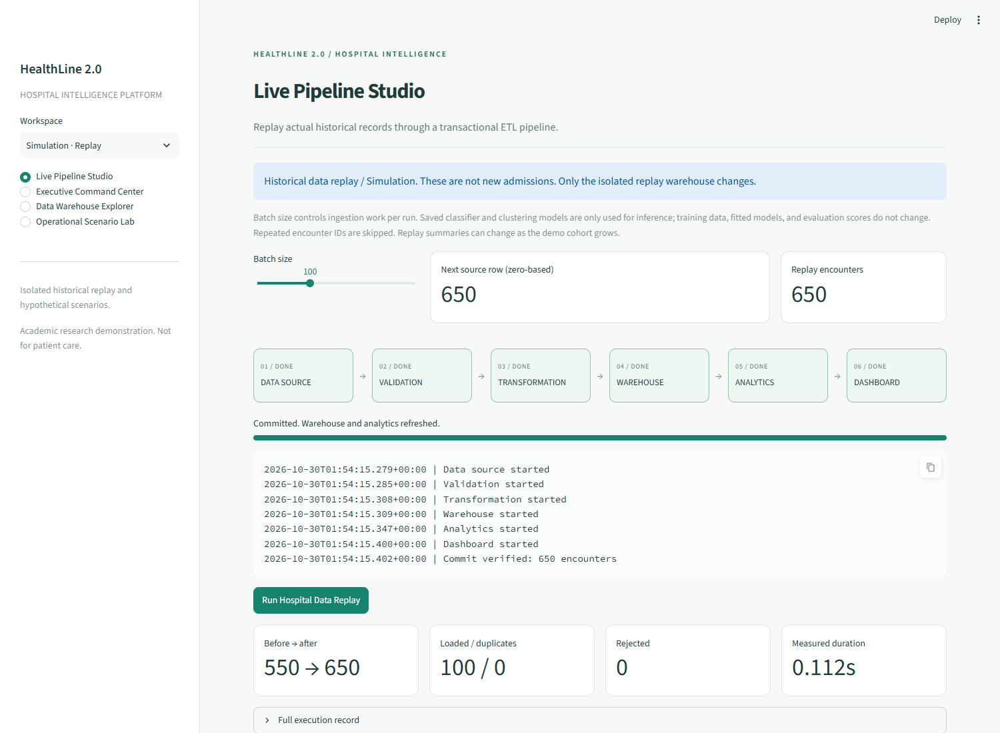

> Navigation update: analytics and simulation now have separate workspaces. Patient Clustering is part of Jury 2 (including its standalone dashboard). Select Simulation · Replay for pipeline, replay warehouse, and hypothetical scenarios. Changing batch size does not retrain models; only replay cohort summaries and processing time change.

# HealthLine 2.0 — implementation review

Prepared 30 October 2026. Local branch: `codex/healthline-2`. No commit, push, merge, or publication was performed. Review the running application at **http://127.0.0.1:8530**.

```powershell
.\.venv\Scripts\python.exe -m streamlit run app.py --server.port 8530
```

## What changed

The implementation keeps Python, Streamlit, SQLite, Pandas, scikit-learn and Plotly. It adds the six requested workspaces, real transactional historical replay, observable ETL, safe SQL exploration, reproducible K-Means/PCA, and separately labeled capacity scenarios. It reuses the newer local trained model and Jury 2 views, rather than the archived binary artifacts or formula.

| Added files | Responsibility |
|---|---|
| `app.py`, `.streamlit/config.toml` | Unified entry point, light theme, local binding |
| `healthline/warehouse.py` | Safe demo initialization/reset, validation, incremental loading, SQL |
| `healthline/intelligence.py` | Clustering and classifier input/output contracts |
| `healthline/scenarios.py`, `healthline/ui.py` | Scenario calculations and six integrated views |
| `healthline/artifacts/*` | Fitted cluster model/scaler/imputer/PCA, assignments, profiles, metrics |
| `tests/test_healthline.py`, `tests/healthline_browser.py` | Acceptance tests and real browser interactions |
| `tools/verify_healthline.py` | Hash preservation, temporary replay evidence, text-candidate checks |
| `docs/HEALTHLINE_DEMO.md` | Three-minute walkthrough |
| `docs/JURY2_README.md` | Exact preserved previous README |
| `docs/healthline_*.json` | Verification, hashes and preservation audit |
| `deliverables/healthline_evidence/*` | Genuine browser screenshots and interaction checks |
| `deliverables/logs/healthline*.xml` | Actual pytest results |

| Modified files | Changes |
|---|---|
| `README.md`, `RUN_FIRST.txt` | HealthLine launch, reproducibility, architecture and limitations |
| `.gitignore` | Excludes runtime replay/scenario DBs |
| `jury_2_dw/app.py` | Moves app startup behind `main()` so existing views can be reused; validates model feature and class ordering |
| `tests/test_platform.py` | Validates preserved sampled association results against the same recorded sample size and seed, instead of incorrectly assuming a full-data run |

The original Jury 1 and Jury 2 dashboards remain separately launchable. Existing Tableau, Power BI, Orange, reports, benchmark, profiles, rules and source exports were retained. No classification retraining was needed.

## Preservation audit

The starting branch was `codex/jury2-finalization`, with existing uncommitted PDF, diagram, mining, documentation and report-tool work. Before implementation, a new branch was created without discarding changes and all 28 pre-existing changed/untracked files were copied into ignored `archive/healthline2_before/`. All 28 were subsequently byte-verified unchanged; see `healthline_preexisting_work.json` for the exact list and starting Git status.

The CSV, canonical historical SQLite warehouse and fitted classifier match their before-work SHA-256 hashes. The original warehouse contains 101,766 fact rows with patient, admission and diagnosis dimensions. It has unique key indexes; the new isolated schema adds declared primary/foreign keys and validation constraints without altering it. Archived legacy binary models and the older duplicate warehouse were also left untouched.

## Actual verification

- Full regression suite: **45 passed**, zero failures/errors/skips, **20.10 seconds**.
- Includes separate workspace navigation, standalone Jury 2 clustering, and equivalence of one 100-row batch versus two 50-row batches (probabilities checked to floating-point tolerance).
- Actual Chrome checks: all six pages, real historical replay, saved classifier inference, SQL explorer and scenario save completed without page errors.
- Original artifact hashes match; all pre-existing changed/untracked files match their backup.
- `git diff --check` passed (only standard Windows line-ending notices).
- Credential-pattern scan of text publication candidates found no matches. Runtime DBs, environment files, credentials and caches are ignored. This is a bounded pattern scan, not a universal privacy guarantee.

Tests use temporary databases. They cover real-batch loading; duplicate and invalid rows; missing schema; failure rollback; concurrent replay cursor safety; SQL and foreign-key integrity; persisted prediction equivalence to the saved preprocessing pipeline; clustering fitting and assignments; PCA rendering; scenario calculations; safe reset; old and new dashboard navigation. Core demonstration data and models are local; the browser run also blocks external HTTP access.

The exact machine-readable measurements are in `healthline_verification.json` and the JUnit files. Evidence timestamps are actual system timestamps. Earlier failed checks were corrected before the successful verification; no failed result is represented as success.

## Warehouse and replay evidence

The temporary evidence run loads **100** genuine historical rows. Re-ingesting exactly that batch loads **0**, records **100 duplicates**, and leaves the fact count at **100**. SQL queries read those persisted records. Predictions and cluster assignments each contain 100 rows. Reset returns the isolated fact count to zero, and the original source/model/warehouse hashes remain unchanged.

The live demonstration warehouse contains the real batches ingested during browser checks. Open Live Pipeline Studio for actual current counts, durations and run IDs. Select Replay in the sidebar to inspect these same records in the executive dashboard and explorer. No rows were added to the original warehouse.



## Clustering and inference results

K-Means uses all **101,766** source encounters, nine documented features, median imputation and StandardScaler. It compares K=2–6 with fixed seed 42 and ten initializations. **K=2** has the highest silhouette, **0.17428**, on the same **2,000-row** scoring sample. PCA's first two components explain **38.09%** of scaled variance.

| Segment | Encounters | Mean medications | Mean historical stay | Observed <30-day readmission |
|---|---:|---:|---:|---:|
| 0 | 64,743 | 12.34 | 2.94 days | 9.78% |
| 1 | 37,023 | 22.46 | 6.95 days | 13.58% |

These descriptive profiles follow the measured results. No clinical phenotype names or validation claims were invented. IDs and readmission targets are not clustering inputs.

The unchanged Random Forest pipeline predicts `NO`, `>30`, `<30` using discharge-stage features and an argmax decision, not a legacy hard-coded formula or binary threshold. Its preserved held-out macro F1 is **0.4330**, accuracy **0.5111**, ROC AUC **0.6503**, and <30-day recall **0.3004**. The probability-column order and input names/order are validated. The application exposes the measured benchmark, permutation importance, mining and profiles.

## Limits for judging

- Historical data, not a live hospital feed; no original encounter dates are fabricated.
- Replay is local and serialized through SQLite, not distributed streaming. Very small batches finish quickly; animation is not artificially delayed.
- Full historical segmentation charts are source-artifact analyses. Replay cluster counts/outcomes are live SQL queries.
- Clusters are encounter-based and modestly separated; repeated patients contribute more than one encounter.
- Readmission inference is discharge-stage, uncalibrated and not prospectively or externally validated. Accuracy does not beat the majority-class baseline.
- Hypothetical capacity calculations are explicit assumptions, not learned forecasts or actual occupancy.
- Preserved current mining outputs use 15,000 rows. Existing PDF/report assets describe a separate prior full-data run and are not regenerated by this upgrade.
- Original Jury 1 rebuild tooling still has its original overwrite semantics; it is never called by the new replay app. Use its documented `--output` option for isolated reproduction.

## Proposed commit and publication gate

Suggested commit title: `Add HealthLine 2.0 transactional replay and hospital intelligence workspace`.

Stage the new HealthLine modules/artifacts, entry point, theme, documentation, tests/evidence, and the five modified upgrade files listed above after review. Existing pre-task modifications should be reviewed as a separate group; do not blindly `git add .`. The exact starting state is preserved in `healthline_preexisting_work.json`.

The remote remains `https://github.com/BitsbyBhargav/Healthcare-Intelligence-Platform.git`. No remote write operation was performed. Publication remains locked until the user explicitly approves the completed implementation and authorizes a push, including the intended branch and approved existing work.
